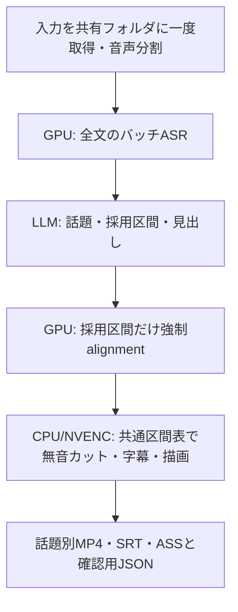

新しいWindows PCへの導入・素材移行・投稿用素材パックは [PC移行ガイド](workstation/README.md) を参照してください。既存の制作入口とモデルは維持します。

# StreamCut

[Colabで開く](https://colab.research.google.com/github/nyu1791-collab/StreamCut/blob/v0.1.1/notebooks/StreamCut.ipynb)

配信アーカイブから話題別の字幕付き下書きを作る、新規開発の小さなPythonパイプライン。

**WhisperXで全文を高速に認識 → LLMで話題・採用区間・見出しを一括選定 → 採用区間だけalignmentし、無音カット・字幕・映像をまとめて出力**します。

ClipForgeの良い点である日本語字幕、元動画から出力への時刻変換、キャッシュ、出力検査を参考にし、分散制御コードは移植していません。GPU4台・CPU4台を使う場合も、設定を増やさず同じ処理を番号で分担します。

> 現状は初版です。合成動画の実FFmpeg処理とオフライン検証を行いますが、Colabの実WhisperX、日本語配信の品質、4GPU/4CPUの実測は別途必要です。所要時間・同時割り当て台数は保証しません。

## 使う工程は3つ



モデルはWhisperXのASR用と日本語alignment用。WhisperX内部でfaster-whisperを使うので、ASRを二重に行いません。話者分離、音源分離、顔追跡、チャット合成、画像検索、BGM、SNS投稿は初版に含めません。

**初版の取得は全動画を一度保存する方式です。** 以前検討した「採用区間だけ映像取得」は未実装です。部分取得後の原点・キーフレーム・別音声トラックの対応を曖昧にせず、共有する一つの元動画からalignment用音声と最終映像を作ることを優先しました。長時間・高ビットレート動画では取得とDrive容量が支配的になります。

## 1つのGPUランタイムで使う

Linux、Python 3.11〜3.13、FFmpeg/FFprobe、fontconfig、日本語フォントが必要です。GPU推論はCUDAが必須で、CPU推論への自動切替はしません。

```bash
sudo apt-get update
sudo apt-get install -y ffmpeg fontconfig fonts-noto-cjk
python -m pip install '.[gpu,fetch]'
streamcut doctor

# APIキーは環境変数 STREAMCUT_API_KEY に設定。モデルIDは明示します。
streamcut run /path/to/source.mp4 \
  --model YOUR_MODEL_ID --project /path/to/new-job
```

配信アーカイブのURLも渡せます。yt-dlpの取得可否に依存し、ライブ配信・プレイリスト一括取得は対象外です。YouTubeの対応には `yt-dlp-ejs` と対応JavaScriptランタイムが必要になるため、[yt-dlp公式手順](https://github.com/yt-dlp/yt-dlp/wiki/EJS)に従って準備してください。Kick/Twitch/YouTubeでの実取得はこの初版では未検証です。

```bash
streamcut run 'https://www.youtube.com/watch?v=VIDEO_ID' \
  --config config.example.json --model YOUR_MODEL_ID --project /path/to/new-job
```

初期値は最大3本・20〜600秒、CUDA/float16、ASR batch 8。VRAMが不足するときは設定ファイルの `batch_size` を下げます。モデルやGPUの種類を勝手に変更しません。ASR・alignment・VADモデルは初回に取得されます。

## Colabで使う

[notebooks/StreamCut.ipynb](notebooks/StreamCut.ipynb)をColabで開きます。

- 最も操作が少ないのは **GPUランタイム1つ、role=`single`**。設定して実行すると最後まで処理します。
- 複数台では **CPUのcoordinator 1つ、GPUワーカー1〜4つ、追加CPUワーカー0〜3つ**。共有Driveフォルダは全台で同じ絶対パスを指定します。
- `gpu_workers=4`、`render_workers=4` は **GPU4台＋CPU4台（coordinatorを含む）**。GPU rankは0〜3、追加CPUのrankは1〜3です。
- ランタイムの起動とDriveの初回マウントは手動です。起動・認証済みワーカー間での工程引き渡しを自動化します。Colabの自動割り当てや自動解放はこのリポジトリでは実装しません。
- GoogleアカウントはColab/Drive側で選択してください。メールアドレスやOAuth情報をコードには埋め込みません。共有Driveの利用権限とColabの実際の割り当て枠を確認してください。

詳しい起動順と復旧は [docs/COLAB.md](docs/COLAB.md)。

## 設定とAPI

`config.example.json`は一つの設定ファイルです。APIはOpenAI互換のHTTPS Chat Completionsエンドポイント一つを指定します。モデルIDは必須で、別モデル・別サービスへの自動fallbackはありません。提供元が `response_format: json_object` に対応している必要があります。

送信するのは文字起こしと話題・時刻・IDです。映像・音声をLLMへ送信しません。本文中の命令はデータとして扱い、モデルの返したID・区間・尺・重複をPythonで検査します。長文だけチャンク化し、話題を統合してから最終選定します。

HTTP失敗や応答不明時には自動再送しません。同じコマンドに `--resume` を付けると、成功した工程を再利用し、失敗した工程を再実行します。応答を確認できなかったAPI呼び出しも明示的な再開時には再送し得るため、提供元の履歴も確認してください。

## 字幕とカット

- 最終映像と同じ元動画から採用区間の音声を抽出し、WhisperXで本文と照合します。
- alignmentできない文字・数字・固有名詞を削除せず、補間した文字数を警告に記録します。発音タイミングの完全な一致を保証しません。
- 無音カットは **低音量かつ発話のない区間** が対象です。単語の時刻も保護します。初期値は1.5秒以上、前後約0.2秒保持。静かなプレイの見せ場は自動では理解できないため、必要なら `silence_cut=false` にします。
- 編集区間は出力のフレーム格子に合わせます。元動画のfpsは30以下なら維持し、30より高い場合は30にします。VFR入力はCFR出力になり、元のすべてのフレームを保存する意味ではありません。
- 音声・映像・字幕は同じ保持区間表から変換します。音声の継ぎ目に5msのフェードを入れます。
- 日本語は形態素の途中で字幕を割らず、フォントの実幅で最大2行にします。短い字幕・読む速度・補間時刻を警告します。ClipForgeのすべての字幕規則を同等に再現したものではありません。
- 見出しと字幕は既定で焼き込み、SRT/ASSも別添します。編集用の素の映像が必要なら `burn_in=false`。焼き込み済み映像にSRTを重ねると二重字幕になります。
- NVENCは小さな実エンコードで判定し、利用できなければ既定の `auto` はlibx264を使います。ColabのGPUがあることとNVENCが使えることは別です。
- 音声にはピークリミッターをかけます。EBU R128の2パス音量正規化は初版には含めません。

## 出力と再開

```text
job/
  project.json          # 設定・処理状態・工程の実秒数
  transcript.json       # 元動画秒数・参照ID・全文
  topics.json           # APIによる話題一覧
  selection.json        # 採用ID・見出し
  clips/01/
    video.mp4
    captions.srt
    captions.ass
    captions.json
    render.json         # フレーム区間表・警告・出力ハッシュ
  input/ audio/ tasks/ results/ cache/ logs/
```

作業フォルダには私有の動画・本文・API応答・エラーログを含みます。公開リポジトリへ入れないでください。ログに元URL等が含まれる場合もあります。フォルダの権限はDriveの共有設定にも従います。

成功したタスクは入力・設定の識別子と出力ハッシュで再利用します。別入力・別設定・別コードでは新しい作業フォルダを使います。生成途中のクリップは仮フォルダへ出力し、復号と長さの検査後に確定します。生成済みの異なる成果物は上書きしません。

`complete`は処理・ファイル検査の完了であり、視聴確認や公開承認ではありません。日本語・話題の面白さ・ゲーム映像の内容は人が確認します。

## 字幕や見出しだけを調整する

ASRやLLMを再実行せず、保存したalignmentから別フォルダへ再書き出しできます。CPUだけで実行可能です。元の納品物は保持します。

```bash
# render-only.json の例: {"font_size": 44, "burn_in": true}
# headlines.json の例: {"01": "新しい見出し"}
streamcut export /path/to/job --config render-only.json --headlines headlines.json
```

出力先は `exports/設定の識別子/clips/`。この入口で変更できるのは字幕・見出し・無音判定・符号化設定で、採用する発言範囲は変えません。

`uv.lock`も同梱しています。依存を固定してローカルに導入する場合は `uv sync --locked --extra gpu --extra fetch`、開発・CPU検証は `uv sync --locked --extra vad --extra dev` を使います。Colabはチェックサム付きのuvと管理されたPython 3.12を準備し、同じlockで導入します。カーネル側のPython/ensurepipや既存パッケージに依存しません。

## 検証・設計

```bash
python -m pip install '.[dev,vad]'
pytest
ruff check .
```

検証は外部LLMやASRモデルを呼びません。合成動画では保存済みの文字起こし・単語時刻と手動選定を使って、実FFmpegでカット・字幕・キャッシュを確認します。GPU推論の成功とは区別します。

- [設計と採否](docs/DESIGN.md)
- [Colabの実行と再開](docs/COLAB.md)
- [実装後の見直しと確認状態](docs/REVIEW.md)
- [参考にした公開実装](docs/SOURCES.md)
